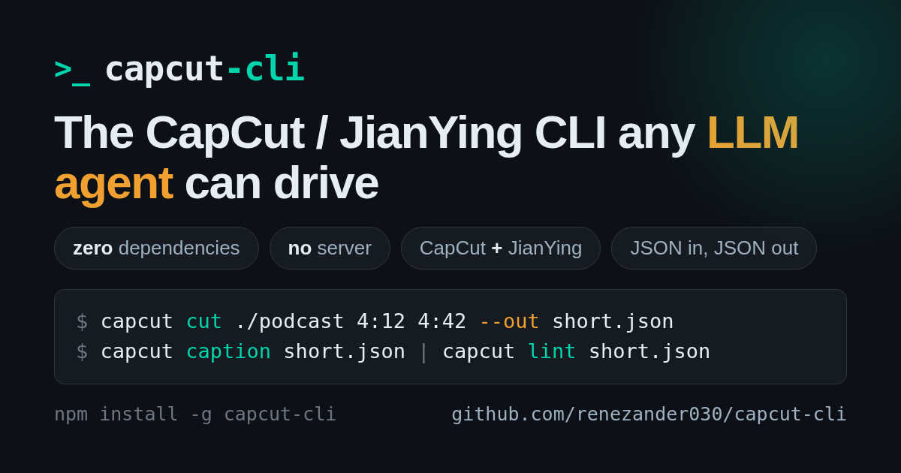

<p align="center">
  
</p>

# capcut-cli

[](https://github.com/renezander030/capcut-cli/actions/workflows/ci.yml)
[](https://www.npmjs.com/package/capcut-cli)
[](https://www.npmjs.com/package/capcut-cli)
[](https://nodejs.org)
[](./LICENSE)

[English](./README.md) | [中文](./README.zh-CN.md) | 日本語

**ターミナルから、または任意の LLM エージェントから、本物の CapCut / JianYing プロジェクトを作成・編集できます。**

結果は、すべてのトラックを編集可能なまま CapCut で開けます。capcut-cli はローカルのドラフトストアを直接操作します。JSON を入れて JSON を出力し、アップロード、API、MCP サーバー、HTTP デーモンは使いません。唯一のオプトインの例外は実験的な `caption --cloud` で、文字起こしする音声を ByteDance にアップロードします。

**メンテナーによるもう一つの作品:** [500 Years Frozen in Time: The Inca Children Mystery](https://www.youtube.com/watch?v=cl8SP3PjspQ)。[Bronze Age Banter](https://www.youtube.com/@BronzeAgeBanter) の 14 分 49 秒のドキュメンタリーです。

`raw recording` → `silence-aware cuts + styled captions` → `editable CapCut / JianYing draft`

**▶ 字幕付きの出力例(35 秒)**

https://github.com/user-attachments/assets/ba6d4f4c-626b-4d09-bcf2-d32471c427be

## インストールして、最初の編集可能なドラフトを開く

**前提条件:** Node ≥ 18(組み込みモジュールのみ。ネイティブモジュールは不要)。一部のコマンドは任意のツールで使えるようになります: `caption` には Whisper、`render` には FFmpeg、メディアのメタデータの自動取得には ffprobe、`translate` には `ANTHROPIC_API_KEY` が必要です。

```bash
npm install -g capcut-cli
```

Python からは、`pip install capcut` が同じバイナリをラップします — `capcut.run("quickstart", "my-short", video="clip.mp4", ratio="9:16")` — [python/README.md](https://github.com/renezander030/capcut-cli/blob/master/python/README.md) をご覧ください。

```bash
capcut doctor
capcut quickstart my-first --video clip.mp4 --srt captions.srt
capcut info ./my-first/ -H
```

**結果:** 動画と字幕が編集可能なトラックに載った、本物のローカルプロジェクトです。フラット化された書き出しではありません。CapCut または JianYing で開いて、確認、調整、レンダリングができます。公開のクリックは人間が行います。

お役に立ちましたか? [capcut-cli に Star](https://github.com/renezander030/capcut-cli) を付けると、ほかの編集者やエージェント開発者が見つけやすくなります。

動画の自動化から出荷前のチェックまで、AI エージェント向けの実用的なツールをもっとお探しなら、[René を GitHub でフォロー](https://github.com/renezander030)してください。

代わりにソースからビルドすることもできます: `git clone https://github.com/renezander030/capcut-cli && cd capcut-cli && npm install && npm run build`(その後 `npm link` で `capcut` を公開します)。インストールせずに任意のコマンドを実行することもできます: `npx capcut-cli <command>`。

> [!IMPORTANT]
> **古いバージョンを使う前にアップグレードしてください。** 0.17.2 までのバージョンで作成したフィクスチャーバンドルには、固定のデバイス識別子が含まれている可能性があり、サニタイズされていないものとして扱う必要があります([#59](https://github.com/renezander030/capcut-cli/issues/59))。0.17.0 までのバージョンには、ローカルのコマンド/フィルターインジェクションの経路や、安全でない一時ファイル・認証情報出力の挙動も含まれています。これらの問題は、それぞれ 0.18.0 と 0.17.1 で修正されています。`npm install -g capcut-cli@latest` を実行し、詳細は[変更履歴](./CHANGELOG.md)をご覧ください。

> **免責事項:** これは独立した、コミュニティが保守するプロジェクトです。CapCut、JianYing、ByteDance Ltd. とは**提携しておらず、後援も推奨も受けていません**。"CapCut" と "JianYing"(剪映)は ByteDance Ltd. の商標です。すべての製品名、ロゴ、ブランドはそれぞれの所有者の財産であり、ここでは識別(指示的)の目的でのみ使用しています。

**あらゆる LLM エージェントが操作できる、CapCut / JianYing の独立した CLI — 依存ゼロ、サーバー不要、1 つのバイナリで両方の名前空間に対応。**

JSON を入れて JSON を出力します。すべてのコマンドがローカルのドラフトストアを直接読み書きし、MCP サーバーや HTTP デーモンは使いません。新しい CapCut のバージョンでは、`draft_content.json` が唯一の信頼できる情報源だと決めつけず、読み取れるすべてのタイムラインの対象を検出して同期します。これにより、どのモデル(Claude、DeepSeek、GLM、Kimi)にも、検査、構築、字幕、キャプション、翻訳、長尺の編集のための決定的な境界が提供されます。

**4 通りの使い方:**

- **CLI** — `npm install -g capcut-cli` を実行し、`capcut <command> <project>` を使います
- **ライブラリ** — `import { loadDraft, lintDraft, saveDraft } from "capcut-cli"`(型付き、依存ゼロ)
- **キューランナー** — `capcut serve` は stdin から JSONL のジョブを読み込みます。[n8n / Make / Coze](./examples/serve-automation.md) 向けです
- **エージェントのサンドボックス(実験的)** — [`capcut-core.wasm`](https://github.com/renezander030/capcut-cli/tree/master/wasm/capcut-core) をビルドすると、ファイルシステム、ネットワーク、環境、時計、乱数、stdio、プロセスのインポートが一切ない、読み取り専用の MCP ツールを 3 つ利用できます

### エージェントにスキルを与える

コマンド 1 つで、`capcut-edit` スキルを Claude Code、Codex、Cursor、OpenCode、および [`skills`](https://skills.sh) インストーラーが対応するそのほかのエージェントにインストールできます:

```bash
npx skills add renezander030/capcut-cli
```

Claude Code では、プラグインとして読み込むこともできます:

```
/plugin marketplace add renezander030/capcut-cli
/plugin install capcut-cli@capcut-cli
```

このスキルは、エージェントにすべてのコマンド、段階的に開示する習慣(まず検査し、ドラフト全体をそのままダンプしない)、macOS と Windows でのドラフトストアの場所、そしてフェード、Ken Burns、長尺から短尺への編集のための決定的なスクリプトを教えます。英語と中国語のリクエスト(剪映、字幕、草稿)のどちらでも発動します。

### エージェント向けの、権限を持たない Wasm ツール

**capcut-cli を AI アシスタントと使っていますか? 「見るだけで触らない」、より安全なモードを与えましょう。**

任意の Wasm ツールを使うと、AI は次のことができます:

- CapCut プロジェクトの中身を説明する。
- 2 つのバージョンの間で何が変わったかを示す。
- タイムラインとキャプションのよくある問題を見つける。

AI が調べられるのは、あなたが渡したプロジェクトの情報だけです。ファイルを閲覧したり、オンラインに接続したり、パスワードや API キーを読み取ったり、ほかのアプリを開いたり、プロジェクトを変更したりすることはできません。

**使うとよい場面:** AI に、できるだけ少ない権限でドラフトをレビューさせたいとき。**使わなくてよい場面:** capcut-cli を自分で使うとき、または AI に編集やレンダリングをさせたいとき(それらは通常の CLI がこれまでどおり行います)。この機能は実験的で任意のものであり、セットアップしない限り何も変更しません。[**技術的な詳細とセットアップ →**](https://github.com/renezander030/capcut-cli/tree/master/wasm/capcut-core#readme)

実験的な [`wasm/capcut-core`](https://github.com/renezander030/capcut-cli/tree/master/wasm/capcut-core) ソースパッケージは、決定的な JSON 入力/JSON 出力の境界を WebAssembly コンポーネントに移します:

- `inspect` は、有効なドラフトに対して `capcut info` と同じ結果になります。
- `diff` は、構造的な変更に対して `capcut diff` と同じ結果になります。
- `lint-portable` は、ホストのファイルやメディアの調査を必要としない、`capcut lint` の明示的でパリティテスト済みのサブセットを実行します。

ホストがドラフトを読み込み、その JSON をツールの入力として渡します。コンポーネント自体は環境からの権限を一切持たず、CI はビルドしたワールドのインポートがゼロであることを確認してから、MCP 経由で [Wassette](https://github.com/microsoft/wassette) を通して 3 つの関数すべてを実行します。ソースのチェックアウトからは `npm --prefix wasm/capcut-core ci && npm run wasm:verify` でビルドします。セットアップとセキュリティの詳細は[コンポーネントの README](https://github.com/renezander030/capcut-cli/tree/master/wasm/capcut-core#readme)にあります。

## リリースノート

> **v0.33.0 の新機能:** `caption` は、キューが字幕を付けずに残した発話を報告し、スタイルだけが変わった場合はキャッシュ済みの文字起こしを再利用します。`loudness --tolerance` と `--max-true-peak` は、終了コードで納品の合否を判定します。`lint` に、オプトインのペース配分と無音区間のチェックが加わりました。`diff --since-write` は、CLI の最後の書き込み以降に CapCut が変更した内容を示します。`fixture --anonymize` は、共有できるバンドルを作ります。`render --burn-captions` は、ドラフト自身のフォントで字幕を描画します。詳細は[変更履歴](./CHANGELOG.md)をご覧ください。

> **v0.32.0 の新機能:** 時間引数は、書き込み前に不正な値や安全でない値を拒否します。翻訳のレスポンスには、入力 1 件につきちょうど 1 つの文字列が含まれている必要があります。字幕のインポートは、不正な UTF-8 を黙ってキャプションのテキストを壊す代わりに拒否します。詳細は[変更履歴](./CHANGELOG.md)をご覧ください。


既存のネストしたプロジェクトでは、編集の前に `capcut diagnose <project> --active-timeline` で選択されたドキュメントを確認してください。このオプトインは、未検証のビルドでもポインターをたどり、無効または競合する選択ドキュメントを拒否します。書き込みガードを迂回することはありません。

CapCut がすでに所有しているプロジェクトに内容を流し込むには、アプリで空のプロジェクトを作成して CapCut を終了し、次を実行します:

```sh
capcut compile spec.json --into /path/to/app-created-project --active-timeline --check
capcut compile spec.json --into /path/to/app-created-project --active-timeline
```

`Timelines/` のないフラットなプロジェクトでは、`--active-timeline` を省略してください。ルートとアクティブなミラーはすべて空でなければなりません。プロジェクトは名前と登録を保ち、キャンバスとフレームレートは、スペックで指定したときだけ変わります。インポートしたメディアはプロジェクトの下にステージングされ、登録とタイムラインのバックアップがまとめてコミットされます。CapCut で開き直し、保存し、閉じて、もう一度開いて、編集が保持されていることを確認してください。自動化された安全性テストがこれらの経路をカバーしていますが、お使いのアプリのビルドでのデスクトップでの受け入れ確認は、まだ行われていません。

## capcut-cli で作られたもの

- [OpenChatCut](https://github.com/0xsline/OpenChatCut) — エージェントが編集したタイムライン、ローカルのメディア、音声、字幕を、レビューとレンダリング用の本物の CapCut / JianYing ドラフトに書き出します。

capcut-cli で何かを作りましたか? 公開リンク、何をするものかを説明する 1 文、そして任意でスクリーンショットやデモを添えて、[ショーケースの issue を立ててください](https://github.com/renezander030/capcut-cli/issues/new?template=showcase.yml)。

プロジェクトの説明は、それぞれのメンテナーが承認したものです。掲載は、推奨や提携を意味するものではありません。


## コマンド

デフォルトは JSON です(`jq` にパイプできます)。人が読みやすい表にするには `-H` を付けます。JianYing の enum 名前空間を使うには `--jianying` を渡します。すべてのフラグは `capcut <command> --help` で確認できます。

| グループ | コマンド |
|-------|----------|
| **検査** | `info` · `tracks` · `materials` · `version` · `lint` |
| **閲覧 / 掘り下げ** | `segments` · `texts` · `segment` · `material` |
| **作成** | `init` · `quickstart` · `compile`(JSON スペックからドラフトを構築) |
| **プレビュー** | `render`(低解像度の ffmpeg プロキシ。CapCut の最終レンダリングではありません) |
| **追加** | `add-video` · `add-audio` · `add-text`(Wikimedia の URL に対応し、ライセンスを確認) |
| **編集 / アニメーション** | trim · speed · volume · transitions · masks · text/image animations · easing curves |
| **テンプレート** | 再利用できるレイアウトの適用と抽出 · `make-preset`(持ち運べるテキストスタイルのプリセット) |
| **字幕と多言語化** | `caption` · `import-srt` · `export-srt`(行単位/単語単位の SRT + VTT) · `translate`(多言語ドラフトの複製) |
| **エフェクト** | `sfx` · `chroma`(クロマキー) · `matting`(スマート背景除去) |
| **長尺 → 短尺** | `cut` · `detect-scenes`(ffmpeg によるシーン切り替えの検出) · `detect-silence` · `detect-retakes`(繰り返しのテイク) |
| **自動化** | `serve`(ステートレスな JSONL ランナー) · `migrate` · `doctor` · `sync-timelines`(8.7 のミラー修復) |

`capcut describe --compact` は、コマンド名、概要、使い方、書き込みの有無を一覧にします。完全な契約は `capcut describe --command compile` で取得でき、複数のコマンドには `--command` を繰り返します。引数なしの `capcut describe` は、従来どおりレジストリ全体を出力します。

すべてのコマンド、オプション、終了コードの**完全なリファレンス**: **[docs/command-reference.md](./docs/command-reference.md)**(简体中文: [docs/command-reference.zh-CN.md](./docs/command-reference.zh-CN.md))。

## スポンサー

capcut-cli は MIT ライセンスで、永久に無料です。スポンサーになると、リリースが速くなり、新しい CapCut / JianYing のバージョンへの対応が同じ週のうちに行われ、さらに上級者向けの特典が使えるようになります:

- **月額 $5 · Supporter** — スポンサー限定のリリースノートと、`BACKERS.md` へのお名前の掲載。プロジェクトを前に進めてください。
- **月額 $25 · Pro** — 非公開の `capcut-cli-pro` リポジトリへの招待: プレミアムのテンプレートとキャプションスタイルのパック、Claude によるバイラルショートの完全なパイプライン、すぐ実行できる `compile` スペック、早期アクセス版のビルド。さらに、issue の優先的なトリアージ。
- **月額 $100 · Team** — 最大 5 人のチームメイトに Pro のすべて、商用利用の書面での確認、この README へのロゴの掲載、チームが必要とする機能の優先的な高速対応。

[**スポンサーになる →**](https://github.com/sponsors/renezander030)

> 仕事で capcut-cli を使っていますか? Team プランは、エンジニアの時間を節約できた最初の午後に元が取れます。

## 商用の依頼

スポンサーとは別に、capcut-cli を製品に組み込む場合や、まだできないことをさせたい場合には、少数の導入支援の依頼をお受けしています。rene@renezander.com まで、何を作っているかをお知らせください。

## 仕組み

CapCut/JianYing は、各プロジェクトをローカルの JSON として保存します。capcut-cli はそのストアを読み込み、バージョンに対応したスキーマで検証し、編集を適用して、アトミックに書き戻します(`.bak` 付き)。プロジェクトのファイルはどこにもアップロードされず、音声を外部に送るのは `caption --cloud` だけです。サービスとして動くものはありません。対応している CapCut/JianYing のバージョンとスキーマのフラグについては [docs/version-support.md](./docs/version-support.md) をご覧ください。

## ドキュメントとサンプル

- [docs/command-reference.md](./docs/command-reference.md) — すべてのコマンドとフラグ([简体中文](./docs/command-reference.zh-CN.md))
- [docs/quickstart.zh-CN.md](./docs/quickstart.zh-CN.md) — 剪映快速上手(JianYing を中心にしたクイックスタート、簡体字中国語)
- [examples/](./examples/) — エンドツーエンドのレシピ(ボイスオーバーの位置合わせ、serve による自動化、字幕の一括修正)
- [docs/version-support.md](./docs/version-support.md) · [docs/jianying-encryption.md](./docs/jianying-encryption.md)
- [CHANGELOG.md](./CHANGELOG.md) · [Releases](https://github.com/renezander030/capcut-cli/releases) — 新着情報
- [draftcat](https://github.com/renezander030/draftcat) — 姉妹プロジェクト: 統制された AI パイプライン(Go、MIT)。同じ単一バイナリで API を使わない設計です
- [skillgate](https://github.com/renezander030/skillgate) — 姉妹プロジェクト: 決定的なゴール判定のゲート(Node、MIT)。テストが通る前にエージェントが「完了」と報告するときのためのものです

## René のそのほかのプロジェクト

capcut-cli は、AI エージェントが安全に実際の仕事をこなせるように作っている、いくつかの CLI のひとつです。エージェントをスクリプトで動かしているなら、次のものも役に立つかもしれません:

- [agentic-task-system](https://github.com/renezander030/agentic-task-system) は、TickTick、Notion、GitHub、Obsidian などを通じて、エージェントにタスクと知識のコンテキストを与えます(CLI + MCP)。書き込みはレビューされ、元に戻せます。
- [skillgate](https://github.com/renezander030/skillgate) は、あなたが定める完了の基準を満たすまでコミットや公開をブロックします。テストが通る前にエージェントが「完了」と言うときのためのものです。
- [agent-approval-gate](https://github.com/renezander030/agent-approval-gate) では、エージェントが下書きをし、人が承認して、その後で初めて実行されます。監査証跡も残ります。

次のプロジェクトは、[René を GitHub でフォロー](https://github.com/renezander030)して確認してください。

## 商標

CapCut™ と JianYing™(剪映)は ByteDance Ltd. の商標です。このプロジェクトは非公式であり、ByteDance とは提携しておらず、推奨も受けていません。これらの商標は、相互運用性を説明するために指示的に使用しています。

## ライセンス

MIT
